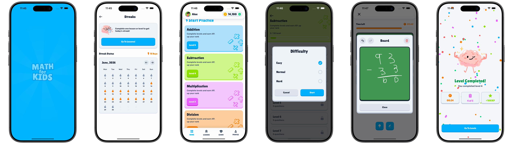

# Math for Kids

A bright, playful arithmetic practice app for iPhone and iPad, built natively with SwiftUI. Pick a subject, choose a difficulty, race the clock through a level of questions, work a sum out by hand on a chalkboard when you're stuck, and collect stars, XP and a daily streak — with springy motion, sound and confetti that make practice feel like a game.



**▶ [Watch the 2-minute walkthrough](docs/demo.mp4)** (recorded on iPhone)

Swift · SwiftUI · SwiftData · PencilKit · Observation · AVFoundation

---

## What's in it

| Flow | Screens |
| --- | --- |
| Start | Animated splash with a loading bar → Home with the learner's name and coin balance in the top bar |
| Choose | Subjects (Addition, Subtraction, Multiplication, Division) → subject detail with levels, stars and locks → difficulty picker (Easy, Normal, Hard) |
| Practice | Timed questions with four answers, a countdown bar, up to three hints per session, and a chalkboard to work problems out by hand |
| Finish | Pass or fail result with time taken, score and XP; a fanfare and confetti on a pass, a gentler sound on a fail |
| Keep going | Streak calendar built from the days a level was finished; a coin Store (demo, no real payments) |

Leaders, Learn and Profile tabs are placeholders for now. Progress, streak days and coins are stored on device with SwiftData, so they survive relaunches.

## Things worth looking at

**A practice session as one observable model**
- `PracticeViewModel` (Observation's `@Observable`) owns the question batch, answer selection and locking, the countdown and the hint flow, so `PracticeView` stays purely presentational.
- Taking a hint auto-completes the question, so it sits behind a confirmation and a limited number of uses (`HintModal`).
- A wrong answer, or a revealed hint, makes the answer buttons wiggle instead of just changing colour.

**Drawing to think**
- `BoardModal` is a chalkboard scratch pad over the question: `DrawingCanvas` wraps PencilKit's `PKCanvasView` for finger or Pencil drawing, with undo, redo and clear that enable and disable as the canvas changes.

**Playful motion, built to be reused**
- `Extensions/PlayfulMotion.swift` holds the app's motion helpers — springy entrances and a `BouncyButton` with bouncy tactile feedback — so every screen moves the same way.
- `ConfettiView` is driven by a `TimelineView`: every piece is placed each frame from elapsed time, so it falls, sways, spins and recycles forever and can't be swallowed by a parent's implicit animation.

**Data on device**
- SwiftData models (`SubjectProgress`, `LevelCompletion`, `PracticeDay`, `Wallet`) hold the learner's level per subject, the completion log, practised days and coin balance; `ProgressStore` is the one place that reads and writes them.
- The app creates its `ModelContainer` itself rather than through the `.modelContainer` modifier, so it can seed a demo streak before any screen reads from it.

**Sound with a safety net**
- `SoundPlayer` plays a bundled audio file by name and falls back to a system sound when the asset isn't in the bundle, so a missing file never means silence.

## Project structure

```
Math-for-kids/
  Math_for_kidsApp.swift     App entry, SwiftData container
  Screens/                   AppRoot (tabs), Splash, Home, Subject, Practice, Streak, Store
    Practice/Components/     Answer buttons, top bar, hint and board modals, drawing canvas, confetti
  Components/                Shared buttons, cards, progress bar, tab bar, shapes
  Models/                    Question, Subject, SwiftData models (progress, streak days, wallet)
  Services/                  ProgressStore, SoundPlayer, navigation routes, demo data
  Extensions/                Fonts, card surface, playful motion
  Resources/                 Fonts and sound effects
```

## Run it

Open `Math-for-kids.xcodeproj` in Xcode, pick an iPhone simulator and press Run (⌘R). Xcode resolves the project's Swift package on first open.

## Credits

Typefaces: Lilita One and Rubik (Google Fonts). Sound effects: Freesound (each file is named after its author). Built by [@okoliken](https://github.com/okoliken).
